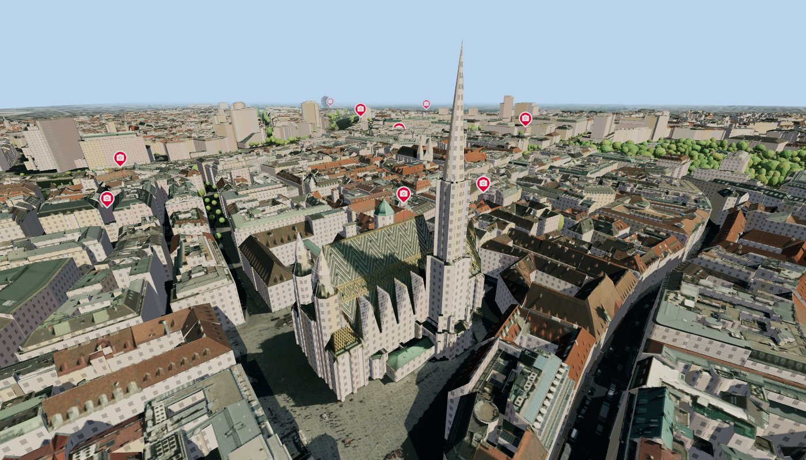
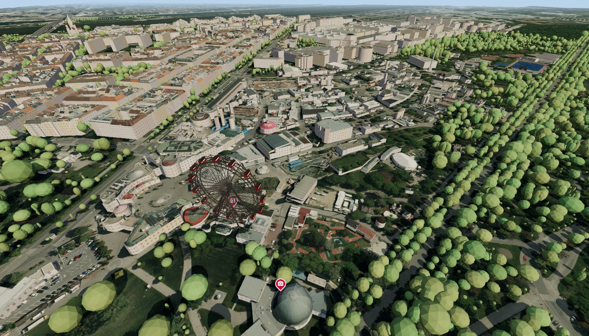
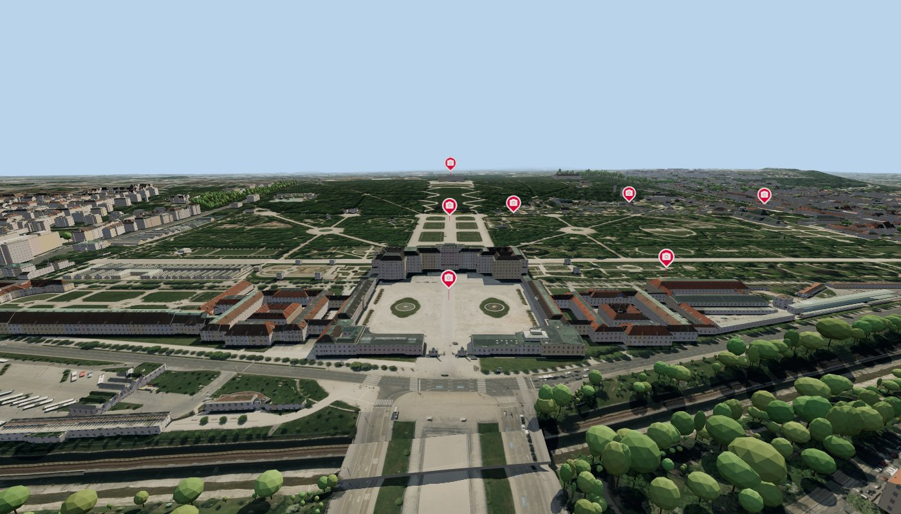
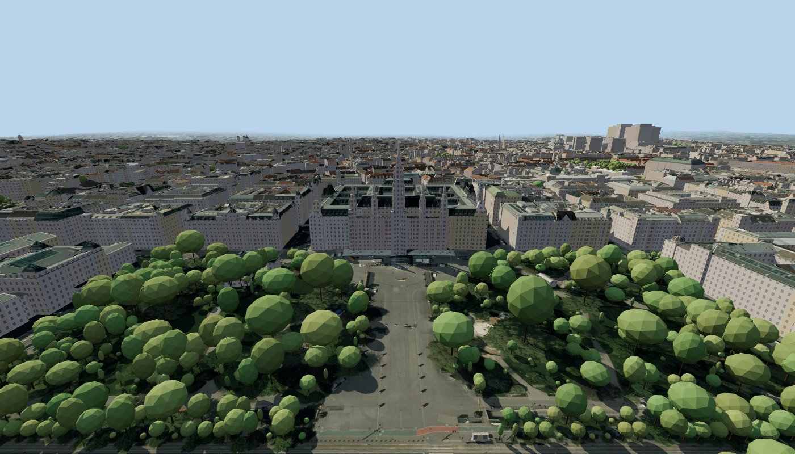

# Wien 3D 🏰🎡

**A "playable" 3D map of Vienna in your browser.** Fly through the whole city like it's a video game (Minecraft creative mode, but it's Vienna): from the Stephansdom spire to the Riesenrad, out to Schönbrunn and over the Donau. Click any building to find out what it is.

Works with keyboard & mouse, on phones and tablets (install it to your home screen for a fullscreen app 📱), and with any Bluetooth/USB game controller 🎮.

No API keys, no accounts, no paid map services. Everything comes from **free open data** that the City of Vienna and Austria published for everyone. ❤️

| | |
| --- | --- |
|  |  |
| Stephansdom | Riesenrad & Prater |
|  |  |
| Schönbrunn | Rathaus |

## What's in it

- 🏙️ **Every building in Vienna** with real roof shapes (the city's LOD2 roof model), streamed in chunks as you move
- 🛰️ **30 cm aerial photos** draped over the ground
- ⛰️ **Real terrain**, from the Wienerwald hills down to the Donauinsel
- 🌉 **Bridges & tunnels** at their real heights
- 🌳 **Trees** from the city's tree register
- 🎡 **The Riesenrad**, built to scale and slowly turning (one lap takes about 4¼ minutes, just like the real one)
- 📍 **Hundreds of POI layers** (press `P`): drinking fountains, museums, public art, toilets, playgrounds, Würstelstände-adjacent things… toggle whatever you like (the city's sights are on from the start)
- 🪧 **Street names** (optional) floating above the streets and bridges, from the city's street graph
- ℹ️ **Click on a building** for info like its address, construction period, true height and more
- 🧭 **Compass** in a corner of your choice (press `K`)
- 🔎 **Address search / teleport** (press `T`, or click / tap the compass): type an address. Every entrance ("Stiege", e.g. Schiffmühlenstraße 58-64/10) and allotment plot (Parz.) is listed with its own location, and picking one takes you straight above it (top-down, north up, 350 m)
- 🦅 **Free flight and noclip**, because sometimes you just want to see the Ringstraße from above
- 🚁 **FPV drone mode** for controllers: throttle, yaw, pitch and roll like a real drone
- 🇦🇹 **Deutsch or English**, switchable in the settings (it starts in your browser's language)
- ⚙️ **Settings** for render distance, resolution, field of view, speed, look sensitivity, display (stats, compass, street names) and controller/touch preferences, remembered in your browser

## Controls

Click or tap anywhere, press any key or any controller button, and off you go.

### Keyboard & mouse 🖱️

| Key | What it does |
| --- | --- |
| `W` `A` `S` `D` + mouse | fly & look around |
| `Space` · `Shift` | fly up · fly down |
| `W` `W` (double-tap) or `R` | sprint |
| Mouse wheel | speed multiplier |
| `N` | noclip (ghost through walls) |
| `1` – `9` | teleport to a landmark (Stephansdom, Prater, Schönbrunn, …), also straight from the start window |
| `P` | POI browser |
| Click | info about what the crosshair points at |
| `X` or right-click | close the info box |
| `M` | mouse mode (free cursor, `M` or a click into the scene to continue) |
| `C` · `K` | coordinates & stats · compass |
| `T` (or click the compass) | find an address / teleport there |
| `Esc` | close box / show the start window |

### Touch 👆

No on-screen buttons, just gestures:

| Gesture | What it does |
| --- | --- |
| Two-finger tap | close the info box / open the menu (with the POI browser) |
| Tap | info about what the crosshair points at; tap outside the info box to close it |
| Drag one finger | move the map: the city follows your finger, sideways and forwards / backwards on the level |
| Drag from the circle around the crosshair | look around; the view moves like a photo, so swiping up looks down and swiping left looks right (swipe fast to whip around) |
| Swipe two fingers up / down | fly straight down / up: the city follows your fingers, so swiping up lowers you |
| Twist two fingers | rotate the map around whatever the crosshair points at |
| Tap the compass | find an address / teleport there |

You only move while your fingers do. Prefer steering the crosshair instead of dragging the view? Invert the look left / right and up / down axes separately in **Settings**, and the two-finger up / down as well. The circle around the crosshair can be hidden there too; swiping from inside it keeps working.

### Controller 🎮

| Button | What it does |
| --- | --- |
| Left / right stick | move / look |
| `RT` · `LT` | fly up · fly down (press gently to climb / sink slowly) |
| `L3` | sprint |
| `RB` (or `A`) | info about what the crosshair points at |
| `LB` (or `B`) | close the info box, POI list or settings |
| `Y` | noclip |
| D-pad ▲ ▼ | speed multiplier |
| D-pad ◀ ▶ | previous / next landmark |
| `Start` · `Back` | menu · stats |

Bluetooth controllers need no extra step: pair it with your phone, tablet or PC as usual, press any button, and you're in. **Settings** shows whether it was found and lets you invert the look axis, swap fly up / down, swap the sticks or switch to **FPV drone controls** (left stick: throttle, centre holds the height, and yaw; right stick: pitch and roll; let go and the drone levels out).

### Install as an app 📲

Open the site on your phone or tablet and choose **Install app** (Chrome / Android) or **Share → Add to Home Screen** (Safari / iOS). It launches fullscreen, without browser bars.

Tip: you can link to a spot with `#lat,lon,height,yaw,pitch` in the URL, e.g. `#48.20813,16.37129,117`.

## The free data behind it 🙏

All of this exists because these folks share their data openly:

| What | Source | License |
| --- | --- | --- |
| Building footprints, trees, POIs, building info | [Stadt Wien – data.wien.gv.at](https://www.data.gv.at/) (WFS `data.wien.gv.at/daten/geo`) | CC BY 4.0 |
| Roof model (LOD2.1, CityGML) | [Stadt Wien – MA 41 Stadtvermessung](https://www.wien.gv.at/stadtentwicklung/stadtvermessung/) | CC BY 4.0 |
| Orthophoto 30 cm | [basemap.at](https://basemap.at/) / Stadt Wien | CC BY 4.0 |
| Address search | [Stadt Wien – address service](https://www.data.gv.at/) (`data.wien.gv.at/daten/OGDAddressService.svc`) | CC BY 4.0 |
| Street names | [Stadt Wien – street graph (GIP)](https://www.data.gv.at/) via data.wien.gv.at | CC BY 4.0 |
| Bridges & tunnels | MA 29, ASFINAG, Wiener Linien via data.wien.gv.at | CC BY 4.0 |
| Surface model (DOM 5 m, for bridge deck heights) | Stadt Wien | CC BY 4.0 |
| Terrain | DGM Österreich 10 m via [AWS Terrain Tiles](https://registry.opendata.aws/terrain-tiles/) | open data |
| Riesenrad 3D model | Modelled by hand in [`src/riesenrad.js`](src/riesenrad.js). Position & orientation: [OpenStreetMap way 97979331](https://www.openstreetmap.org/way/97979331) (© OpenStreetMap contributors). Dimensions: [Wikipedia: Wiener Riesenrad](https://de.wikipedia.org/wiki/Wiener_Riesenrad) | ODbL (position) |

Built with [three.js](https://threejs.org/), [three-mesh-bvh](https://github.com/gkjohnson/three-mesh-bvh), [earcut](https://github.com/mapbox/earcut), [polygon-clipping](https://github.com/mfogel/polygon-clipping), [fflate](https://github.com/101arrowz/fflate), [proj4js](https://github.com/proj4js/proj4js), [geotiff.js](https://github.com/geotiffjs/geotiff.js) and [Material Design Icons](https://pictogrammers.com/library/mdi/).

## Run it yourself

```bash
npm install
npm run dev
```

Then open the URL Vite prints and click anywhere to play. That's it! 🎉

`npm run build` makes a production build in `dist/`. It deploys to Vercel as-is: `api/lod2/[sheet].js` is a small serverless function that converts the city's roof model to a compact binary on the fly (the Vite dev server does the same thing locally).

Optional data prep scripts (the results are already committed in `public/data/`):

- `npm run build:structures`: rebuilds bridges & tunnels (downloads ~370 MB into `.cache` on the first run)
- `node scripts/build-poi-layers.mjs`: rescans the city's WFS for POI layers
- `node scripts/build-icons.mjs`: redraws the app icons in `public/icons/`

## License

[MIT](LICENSE). Use it, fork it, remix it, learn from it, show it to your friends. 💛

The map data stays under its own licenses (mostly CC BY 4.0, see above), so please keep the attributions if you build on it.

---

Made with ☕ and a bit of Wiener Schmäh. Baba! 👋
